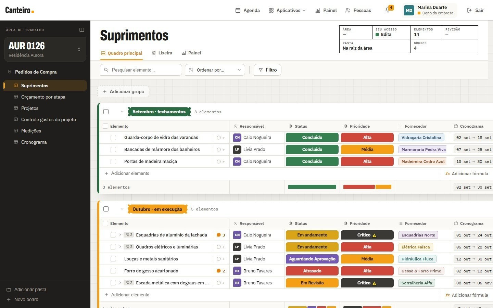
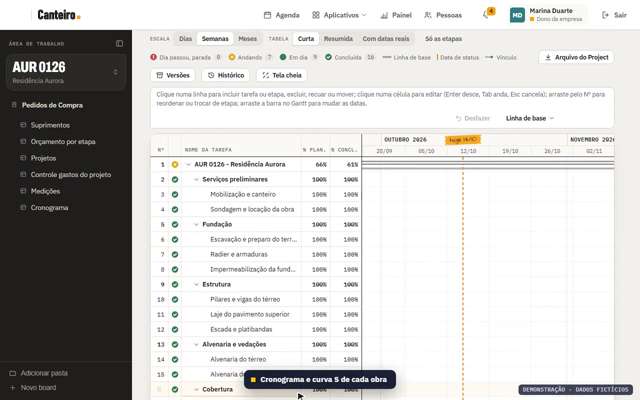
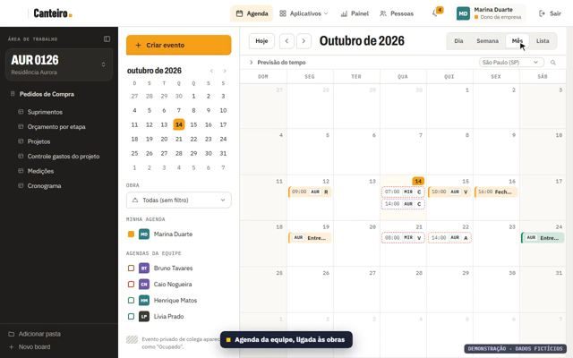
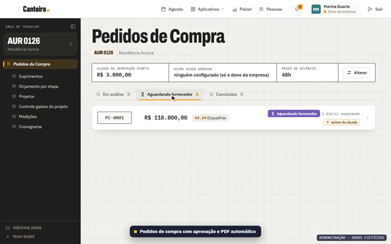
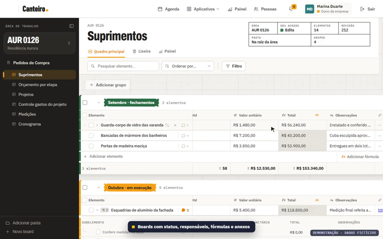
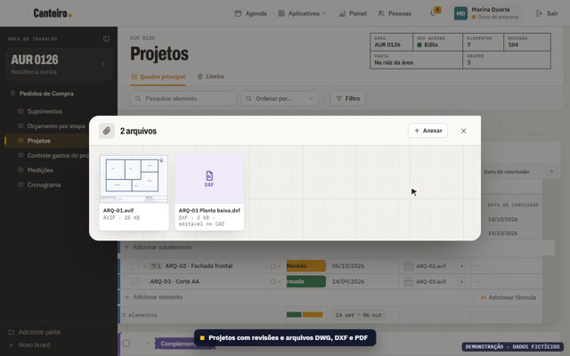
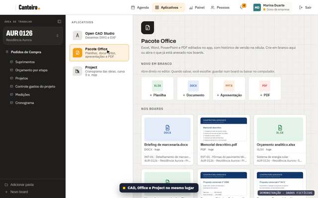
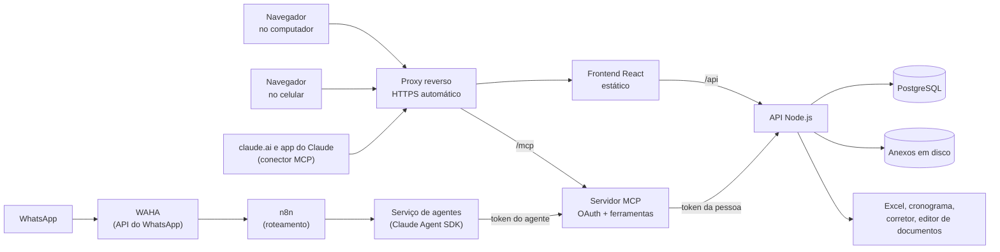

# gestao-obras-case

Estudo de caso do **Canteiro**, um sistema interno de gestão de obras em que trabalhei e que uma construtora usa em produção: pedidos de compra, obras, cronograma, agenda, planilhas, painel do dono, versão para celular, acesso por perfil e agentes de IA por MCP. "Canteiro" é o nome neutro que este repositório usa para o sistema.

> **Código-fonte não é público (propriedade da empresa); demo com dados fictícios sob pedido.**
> Este repositório tem texto, imagens e um único script de 23 linhas, em [docs/numeros.md](docs/numeros.md), que valida os diagramas. Nenhum código do sistema, nenhum dado real, nenhum nome de cliente, obra, fornecedor ou funcionário. Onde precisei de exemplo, usei dados inventados (a empresa é "uma construtora"; as obras, pessoas e fornecedores das imagens também são inventados).



*Tela real do sistema rodando num ambiente de demonstração isolado, com dados fictícios. Origem de cada imagem em [img/README.md](img/README.md).*

## Contexto

Uma construtora gerenciava obras, compras e finanças num serviço de quadros (estilo planilha com status e responsáveis) cobrado por usuário. O preço crescia a cada pessoa que entrava, e o dono precisava de coisas que o serviço não dava: acesso por quadro (o cliente da obra enxerga o andamento, mas nunca o custo interno), pedido de compra com alçada de aprovação, cronograma de obra e um jeito de a equipe operar pelo Claude, inclusive pelo celular.

Em 10/09/2026 o sistema próprio entrou no ar. Em 28/10/2026, 48 dias depois, o CHANGELOG já tinha 114 versões numeradas ([docs/linha-do-tempo.md](docs/linha-do-tempo.md)).

## Problema

- **Custo por usuário** que escalava mal com a equipe.
- **Permissão grossa demais:** o cliente da obra tem que ver o cronograma e as fotos, e não pode ver o quadro de custo e margem da mesma obra.
- **A operação não cabia na tela.** O dono estima que mais de 80% do trabalho do dia entra pedindo ao Claude (claude.ai ou celular) e não clicando na tela. É estimativa dele, não medi..
- **Dado delicado junto:** telefone, CNPJ e e-mail de fornecedores, valores de contrato, finanças.
- **Sem parar a empresa:** a troca de sistema tinha que preservar tudo o que já existia (itens, valores de coluna e anexos).

## Solução

Um sistema web próprio, com o mesmo modelo mental que a equipe já usava (**área de trabalho → quadro → grupo → elemento**), mais o que faltava:

| Módulo | O que faz |
|---|---|
| Quadros | Grupos coloridos, subelementos, colunas tipadas (status, pessoa, data, período, arquivo, número, fórmula), anexos com prévia, comentários com @menção, histórico de cada célula |
| Perfis de acesso | 4 papéis-base (dono da empresa, TI, funcionário, dono da obra/cliente), mais perfis com nome próprio criados sobre um deles (por exemplo, "Projetista"), mais conta de serviço; concessão quadro a quadro, checada no servidor |
| Pedidos de compra | Nasce de um quadro, alçada de aprovação, PDF, envio por WhatsApp, aceite do fornecedor (ou por silêncio depois de um prazo), centro de custo |
| Cronograma | Lê arquivos do MS Project (.mpp) e gera um XML que o MS Project abre; edição na tela, curva S, "cronograma vivo" (a data de status é hoje) |
| Agenda | Estilo calendário, convites, sugestão de outro horário, evento privado vira "Ocupado", previsão do tempo |
| Planilhas e documentos | Excel, Word, PowerPoint e PDF editados dentro do sistema (ONLYOFFICE), com versão por célula; CAD (DWG/DXF) aberto no PC da pessoa |
| Fórmulas | Estilo Excel, em português, por coluna, por rodapé e dentro de uma célula; calculadas no servidor |
| Painel do dono | Montado por widgets e **customizável pelo Claude** (ferramentas MCP), com histórico de versões e desfazer |
| Diário de Obra (RDO) | Manhã e tarde, ou um só por dia (por obra), mão de obra por empresa, clima automático e gratuito, PDF |
| Gerente de obra | Agente que escuta grupos de WhatsApp da obra, lista combinados e prazos; só cobra no grupo com aprovação humana |
| Celular | Tela de campo (fotos em rajada, ata, agenda, pedidos), escolhida sozinha pelo aparelho |
| Claude por MCP | Conector remoto com login OAuth por pessoa e 65 ferramentas; o mesmo servidor atende os agentes do WhatsApp |
| Rede de proteção | Lixeira de 30 dias, arquivo morto, criptografia de campo, backup diário, texto revisado pelo Claude |

Mais telas do mesmo ambiente de demonstração (dados fictícios; origem em [img/README.md](img/README.md)):

| | |
|---|---|
| <br>Cronograma da obra: status, % planejado e % concluído, linha do tempo | <br>Agenda da equipe, ligada às obras |
| <br>Pedidos de compra, com alçada e abas por situação | <br>Fórmulas no quadro: total por linha e rodapé por grupo |
| <br>Projetos: revisões e galeria de anexos (imagem e DXF) | <br>Menu Aplicativos: CAD, Office e Project |

## Diagrama

Visão geral. Detalhes, fluxos e backup em [docs/arquitetura.md](docs/arquitetura.md).



## Stack

React 18 e Vite (CSS próprio, sem kit de UI; só a Agenda usa FullCalendar) · Node.js e Express · PostgreSQL · servidor MCP (SDK oficial, Streamable HTTP, OAuth 2.1) · Claude (Agent SDK) · n8n e WAHA · Python com Flask (leitura de Excel, cronograma com a biblioteca MPXJ) · LanguageTool · ONLYOFFICE · Docker Compose · Caddy (HTTPS automático).

## Resultado

Números contados com os comandos de [docs/numeros.md](docs/numeros.md), executados com o Claude Code no código privado em 28/10/2026. Cada um tem o comando lá, com os nomes de pasta generalizados.

| O quê | Valor |
|---|---|
| Versões no CHANGELOG (de 10/09 a 28/10/2026) | 114 versões distintas, 115 entradas, 24 dias com lançamento |
| Declarações de rota HTTP no backend | 292 (112 GET, 110 POST, 22 PUT, 17 PATCH, 31 DELETE) |
| Ferramentas MCP | 65 (58 gerais e 7 de automação, só para quem pode automatizar) |
| Tabelas no schema do PostgreSQL | 71 |
| Componentes React (`.jsx`) | 56 (50 de mesa, 6 do celular), mais 32 arquivos CSS |
| Linhas de código | cerca de 23,5 mil de JavaScript no backend, 28,8 mil de JSX no frontend, 1,7 mil de SQL |
| Serviços no Docker Compose | 16 |
| Testes puros executados (sem banco) | 4 arquivos, 4 passando |
| Linhas do CHANGELOG que citam a auditoria retroativa | 41 linhas (em 40 entradas distintas); 31 linhas dizem "nada a ajustar" |

## Como rodar

Não há o que rodar do sistema aqui: o repositório é só documentação, imagens e um script de validação dos diagramas.

O sistema de verdade sobe com `docker compose` (16 serviços), mas o código é privado. O que dá para fazer:

1. Ler os documentos no GitHub. Os diagramas Mermaid aparecem renderizados.
2. Pedir a **demo com dados fictícios**. Ela roda num ambiente isolado (banco novo, rede própria, seis pessoas inventadas), que é de onde saíram as imagens.
3. Conferir os números: eles saem de comandos `grep`, `wc` e `awk` sobre o código privado, listados em [docs/numeros.md](docs/numeros.md) com os nomes de pasta generalizados. Quem tiver acesso ao código repete tudo em segundos.

Os blocos Mermaid deste repositório foram validados com o `mermaid.parse()` (versão e método em [docs/numeros.md](docs/numeros.md), seção "Validação dos diagramas"): 7 blocos, 0 erros de sintaxe.

## Estrutura de pastas

```text
gestao-obras-case/
├── README.md                   # este arquivo
├── LICENSE
├── .gitignore
├── docs/
│   ├── arquitetura.md          # componentes, fluxos, rede, backup (Mermaid)
│   ├── decisoes.md             # decisões de projeto no estilo ADR
│   ├── seguranca.md            # o que foi feito, sem expor configuração
│   ├── linha-do-tempo.md       # releases por versão, generalizadas
│   └── numeros.md              # cada número com o comando que o gerou
└── img/                        # telas da demo fictícia (origem em img/README.md)
```

## Decisões de projeto

As principais, em uma linha cada. O raciocínio, as alternativas e o custo de cada uma estão em [docs/decisoes.md](docs/decisoes.md).

- **Lixeira em vez de apagar:** excluir tira uma "foto" do que sai e só então apaga; restaurar devolve com os mesmos ids.
- **Criptografia de campo** só onde nenhuma consulta SQL precisa do texto puro.
- **Perfis por quadro**, checados no servidor; cliente da obra só lê e nunca recebe a área inteira.
- **MCP primeiro:** o Claude é a porta de entrada, com a permissão da pessoa que logou e sem lista duplicada.
- **Migração sem parar**, com scripts que podem rodar duas vezes e contagem antes e depois.
- **Auditoria retroativa:** toda regra nova também vale para os dados antigos, com prova em números.
- **Deploy só depois de validar local** e de um "pode subir" explícito do dono.

## Limitações / o que ficou de fora

- **Não é open source e não dá para rodar.** Este repositório é prova de trabalho, não um produto.
- **O histórico no git é curto:** o repositório privado tem 15 commits (de 25/09 a 09/10/2026). Antes disso, e depois, o registro confiável é o CHANGELOG.
- **Testes automatizados são poucos.** Há 4 arquivos de teste puros em JavaScript (executados com o Claude Code: 4 passam) e 7 scripts de integração em Python que exigem o sistema rodando, mais 1 script do modo fornecedor (`teste_modo_fornecedor.mjs`, nome generalizado neste texto; usa WAHA falso, roda dentro do contêiner e chama o modelo); estes 8 não foram executados para este estudo. Boa parte da validação foi manual, no navegador e pela API, e está descrita nas entradas do CHANGELOG.
- **Parte dos campos fica sem criptografia de campo**, de propósito e por razões funcionais; ver ADR-002.
- **CAD:** o salvar de volta (o primeiro Ctrl+S real num PC de usuário) e o instalador por https ainda não foram provados; só o fluxo por ticket e API foi exercitado.
- **Celular:** validado no navegador em 390x844, não em iPhone físico (câmera e permissão do Safari pendentes).
- **Defesa contra injeção de prompt é probabilística.** A contenção de verdade é limitar as ferramentas de cada agente em código.
- **Parte do que descrevo está só no ambiente local:** as versões 1.53.0 e 1.55.0 constam no CHANGELOG como ainda não subidas na data da leitura (28/10/2026). A 1.61.0 subiu para produção nesse mesmo dia.

## Licença

MIT, copyright 2026 Rafael M. da Silva Santos (arquivo [LICENSE](LICENSE)). Vale para os textos e diagramas deste repositório. O código-fonte do sistema descrito não está aqui e pertence à empresa.

As imagens em `img/` **não** são cobertas pela licença MIT: são capturas de interface proprietária da empresa, de um ambiente de demonstração com dados fictícios, usadas com autorização do dono.
