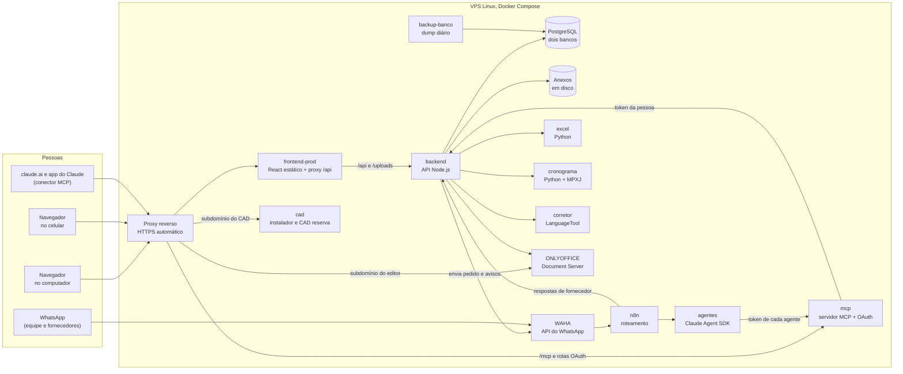
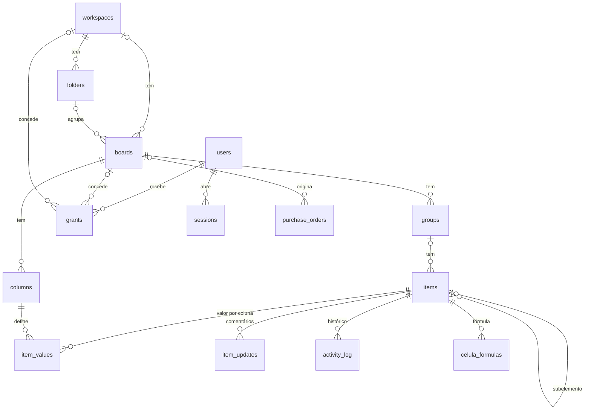
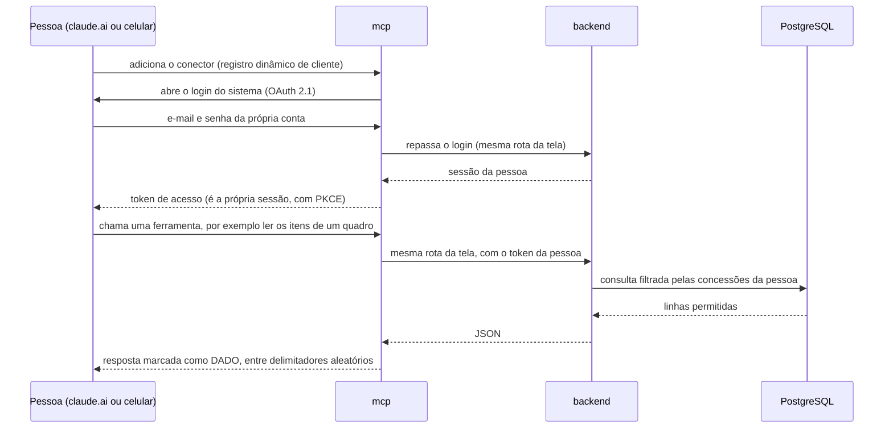
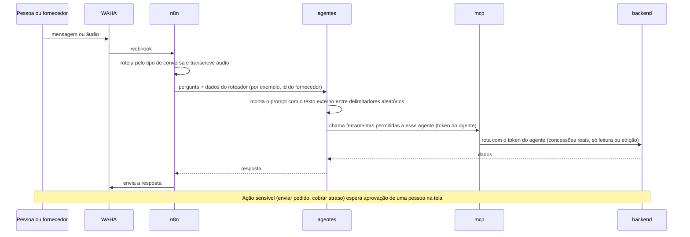
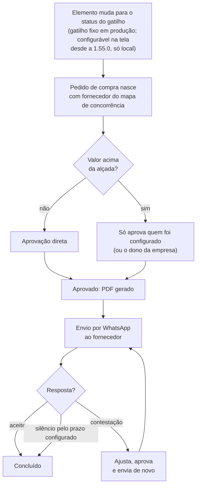
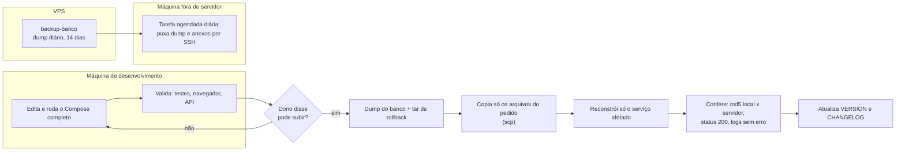
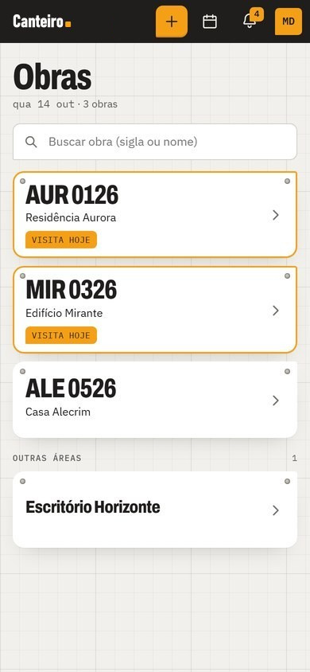

# Arquitetura

Como o Canteiro está montado, sem endereços, chaves nem nomes reais. Os nomes de serviço abaixo foram generalizados a partir dos do Docker Compose, e os domínios foram trocados por descrições. Os nomes de tabela do banco são mantidos como no schema real.

Resumo: uma SPA em React, uma API em Node.js sobre PostgreSQL, um servidor MCP que deixa o Claude usar a mesma API com a permissão de quem está logado, e o n8n com o WAHA levando o WhatsApp até agentes de IA. Tudo em Docker Compose numa VPS Linux, atrás de um proxy reverso que cuida do HTTPS.

## 1. Visão geral

| Serviço | Papel | Tecnologia |
|---|---|---|
| `caddy` | Termina HTTPS (certificado automático), separa `/mcp` e o OAuth do resto, serve subdomínios do editor, do CAD e do celular | Caddy |
| `frontend-prod` | Serve o bundle estático e repassa `/api` e `/uploads` para a API | Express |
| `backend` | API, regras de negócio, motor de automações, lixeira, fórmulas, pedidos, diário de obra, agenda | Node.js, Express, `pg`, `sharp` |
| `mcp` | Servidor MCP remoto (Streamable HTTP) com OAuth 2.1 e registro dinâmico de clientes | SDK oficial do MCP |
| `agentes` | Executa os agentes do WhatsApp e o assistente do app, cada um com lista própria de ferramentas | Claude Agent SDK |
| `postgres` | Dois bancos: o do sistema e o das cotações dos agentes de compras | PostgreSQL |
| `backup-banco` | `pg_dumpall` diário, retenção de 14 dias | PostgreSQL (cliente) |
| `n8n`, `waha` | Entrada do WhatsApp, roteamento por tipo de conversa, transcrição de áudio | n8n, WAHA |
| `excel` | Lê planilhas de cotação (.xlsx e .xls) | Python, Flask, openpyxl, xlrd |
| `cronograma` | Lê e gera arquivos de cronograma do MS Project | Python, Flask, MPXJ via JPype |
| `corretor` | Corretor ortográfico sob demanda | LanguageTool |
| `onlyoffice` | Edita planilha, texto, apresentação e PDF dentro do sistema | ONLYOFFICE Document Server |
| `cad` | Entrega o instalador do agente de CAD e um CAD de reserva no navegador | nginx, arquivos estáticos |

O Compose tem 16 serviços; alguns só sobem com um perfil (o proxy reverso só no perfil de produção, o front de produção nos perfis de produção e de demonstração, e um túnel só no perfil de demonstração). Em produção entra um arquivo de sobreposição que muda poucas coisas (cookie de sessão só por HTTPS, ajustes para o proxy e as URLs públicas do editor e do CAD). Local e produção usam o mesmo Compose; o que não existe localmente é o proxy e o HTTPS.

## 2. Modelo de dados em uma página

O PostgreSQL do sistema tem 71 tabelas. O núcleo é a hierarquia que a equipe já conhecia, mais permissões e histórico:

- **Valores de célula** ficam numa tabela só (`item_values`), com um índice GIN (`jsonb_path_ops`) para localizar anexos por conteúdo. Isso deixa o quadro flexível, mas é também uma das razões de nem todo campo ser cifrado (ver [ADR-002](decisoes.md)).
- **`grants`** liga pessoa a quadro (ou a área, para quem pode). É o que o servidor consulta em toda rota.
- **`sessions`** guarda sessão de navegador e token de serviço na mesma tabela, para poder revogar na hora. O token de serviço vale para integrações e para cada agente.
- **`lixeira`** guarda a "foto" em JSON do que foi excluído (ver [ADR-001](decisoes.md)).
- Tabelas de módulos (pedidos, agenda, cronograma, diário de obra, gerente de obra, automações) apontam para o núcleo por id. Quando uma delas aponta para área, quadro ou elemento, entra também no mapa de dependências da lixeira.

## 3. Uma requisição da tela

1. O navegador chama `/api/...` no domínio do sistema. O proxy entrega ao `frontend-prod`, que repassa à API.
2. A API lê o cookie de sessão (httpOnly, Secure em produção) e carrega a pessoa e as concessões dela.
3. Cada rota confere o acesso **no servidor**, com uma checagem por quadro, nunca na tela. O front só esconde botão.
4. A rota fala com o PostgreSQL por uma conta de banco de privilégio mínimo.
5. Mudança grava no histórico de atividade com antes e depois.
6. O quadro não recarrega por inteiro: o cliente consulta um contador de revisão e só rebusca quando o número muda.

## 4. Claude como porta de entrada (MCP)

A maior parte do trabalho do dia entra pedindo ao Claude. Por isso o servidor MCP é um serviço de primeira classe e não um adaptador.

- **Sem lista de permissões duplicada.** O MCP não decide nada: quem filtra é a API, com as mesmas concessões da tela. Duas listas teriam saído de sincronia.
- **Resposta marcada como dado.** Tudo o que volta de uma ferramenta foi digitado por gente em algum campo. Cada resposta é embrulhada num delimitador sorteado a cada chamada, junto com o lembrete de que aquilo não é instrução.
- **Sem sessão em memória.** O transporte é sem estado. Antes, uma conversa aberta continuava mandando o identificador de sessão antigo depois de um deploy e parecia que as ferramentas tinham sumido.
- **Anotações de risco.** Cada ferramenta declara se só lê, se escreve ou se é destrutiva (só excluir elemento e excluir evento), e o cliente usa isso na tela de permissão.
- **65 ferramentas.** 58 gerais (quadros, itens, colunas, fórmulas, agenda, painel, diário de obra) e 7 de automação, que só aparecem para quem tem a permissão de automatizar.

## 5. WhatsApp, agentes e aprovação humana

- **Um agente, uma conta.** Cada agente tem conta própria de serviço, com concessões quadro a quadro, igual a uma pessoa. A trava de ferramenta por agente (`canUseTool`) fica em código, antes de cada chamada.
- **O agente que fala com fornecedor não tem shell.** Quem escreve para ele é gente de fora. Ele usa quatro ferramentas estreitas, presas ao id que o roteador do n8n passa, e não ao que o modelo escolhesse.
- **O pedido de compra nasce da mudança de status de um elemento** (pela tela ou por qualquer ferramenta que mude esse status, inclusive o Claude). **Aprovar e enviar ao fornecedor não é ferramenta do Claude:** o envio por WhatsApp espera a aprovação de uma pessoa com alçada, na tela.

## 6. Pedido de compra

O PDF do pedido, em produção, é desenhado em código. O PDF feito pela IA sobre o modelo vigente do documento também é da 1.55.0 e está só no ambiente local.

O centro de custo entra no pedido (alocação obrigatória, com divisão entre centros) e alimenta o painel do dono.

## 7. Deploy, ambientes e backup

- **Dois níveis de backup.** Dentro da VPS, o `backup-banco` faz um dump diário de todos os bancos e papéis e guarda 14. Fora dela, uma tarefa agendada em outra máquina puxa por SSH o dump e os anexos todo dia e avisa se ficar 2 dias sem dump novo. Antes de cada deploy, mais um dump e um arquivo de rollback com os arquivos que vão ser trocados.
- **Deploy por lista de arquivos.** Como outras sessões do Claude Code podem mexer no mesmo diretório local, o deploy copia só os arquivos do pedido e compara o hash local com o do servidor antes de assumir qualquer ponto de partida.
- **Editor de documentos em subdomínio próprio**, isolado da origem do sistema.

## 8. Tela de mesa e tela de campo

A mesma SPA tem dois conjuntos de telas, carregados sob demanda:

- **Mesa:** quadros densos, painel, cronograma, editor de planilha, automações. 50 componentes `.jsx`.
- **Campo (celular):** obras, fotos em rajada, ata, agenda, pedidos, avisos e diário de obra, 6 componentes `.jsx`. O aparelho escolhe sozinho (tela estreita com toque, ou navegador de celular), sem botão de troca. O pacote do celular não carrega o código do quadro.

Ficaram fora do celular de propósito: cronograma, centros de custo, automações, pessoas, editor de planilha e de documentos, lixeira e edição de colunas ou fórmulas (continuam no computador). O painel do dono abre no celular desde a 1.50.5, só para o dono da empresa.

## 9. Limites conhecidos da arquitetura

- **O quadro renderiza tudo no cliente.** Num quadro muito grande a tela fica visivelmente mais lenta; virtualizar a lista é o próximo passo e não foi feito.
- **Anexos em disco local.** Sem armazenamento de objetos; o backup fora da VPS é o que protege.
